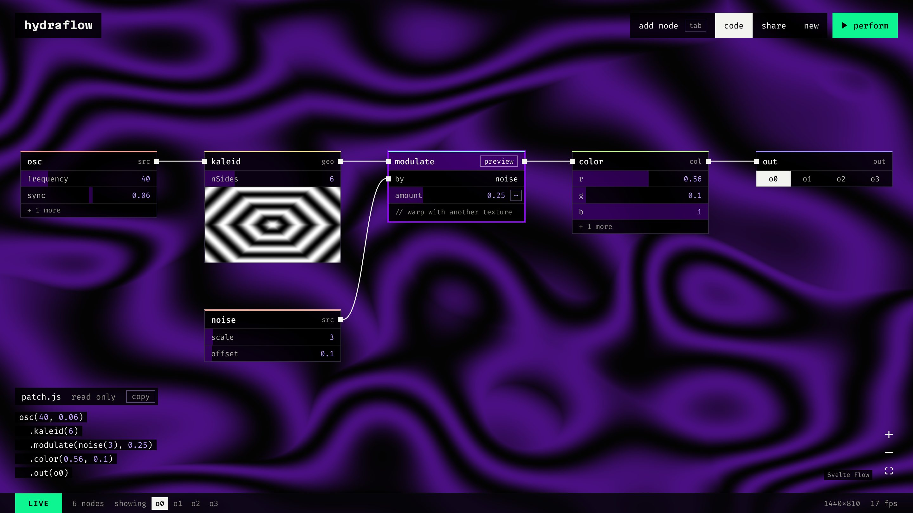

# hydraflow

[](https://github.com/dxviie/hydraflow/actions/workflows/ci.yml)
[](./LICENSE)

A node-based editor for [hydra](https://hydra.ojack.xyz/): wire sources, transforms and blends
together, and watch the result play behind your patch. From the same family as
[HYDRACTRL](https://github.com/dxviie/HYDRACTRL), which is where a patch can go next: every patch
is also a hydra sketch you can copy out.

This is an early version. It runs in the browser and keeps your patch in the browser's storage.

## What it does

- **Every hydra function is a node.** The catalog is read from hydra's own definitions, so names,
  parameters and defaults are hydra's. On top of those: `out` (o0 to o3) and `src` (read an output
  back in, for feedback).
- **Bring things in**: `cam`, `screen`, `image` and `video` nodes, up to four at a time, as hydra
  has four inputs. Drop a picture or a video on the canvas, or choose one in the node. Your files
  are kept in this browser and go nowhere else.
- **The output plays fullscreen behind the patch**, dimmed while you edit and at full strength
  when you perform.
- **A node shows what you need, when you need it.** At rest: the one or two parameters that
  matter. Selected: all of them, a line on what the node does, and what can drive each one.
  Folded: one line of code, `osc(40, 0.06)`.
- **Every value is set by dragging.** Drag a row sideways (Shift for fine steps), or double-click
  to type a number, also one outside the row's range.
- **`~` makes a number move**: a sequence, an LFO, an audio band or the mouse. The microphone is
  only asked for once something listens to it.
- **A live preview on any node**, to see the picture at that point of the chain.
- **Adding is quick.** Tab or a double-click opens a search. With a node selected the new node
  joins its chain and the rest moves along; with a wire selected it goes into that wire; a wire
  dropped on empty canvas asks what should go there.
- **Deleting a node closes the gap** it leaves in its chain.
- **The patch as code**: the `code` button shows it as a hydra sketch, ready to paste into
  HYDRACTRL or any hydra editor. A file of yours is written as `/media/<name>`, where HYDRACTRL's
  desktop app serves its media folder.
- **Share a patch as a link.** The patch travels in the part of the address after the `#`, so no
  server ever sees it. Files don't travel: whoever opens the link chooses their own. Opening a
  link sets your own patch aside, and one click brings it back.
- **Undo and redo**, and the patch is back when you reload.

## Keys

| | |
| --- | --- |
| Tab, or double-click the canvas | Add a node |
| Backspace / Delete | Remove the selected nodes or wires |
| Ctrl/⌘+Z, Ctrl/⌘+Shift+Z | Undo, redo |
| Ctrl/⌘+` | Hide the editor and perform; Esc brings it back |
| Double-click a node's title | Fold it into one line, or open it again |
| Shift while dragging a value | Fine steps |
| ← / → on a focused row | One step (Shift: ten) |

## Develop

hydraflow is a [Svelte 5](https://svelte.dev/) app built with [Vite](https://vite.dev/), using
[Bun](https://bun.sh/) for installing, scripts and tests.

```bash
bun install
```

```bash
bun dev
```

| | |
| --- | --- |
| `bun dev` | Dev server with hot reload |
| `bun run build` | Production build into `dist/` |
| `bun run preview` | Serve the production build |
| `bun test` | Unit tests |
| `bun run check` | Type-check the Svelte and TypeScript sources |
| `bun run lint` / `bun run format` | Biome |

The build is a static site: any static host works, with `bun run build` as the build command and
`dist` as the output directory.

## How it is put together

- `src/lib/graph/` is the patch itself, with no browser or Svelte in it: the types, the compiler
  from a patch to hydra (`compile.ts`: as code to read, and as hydra's own chain objects to run),
  what drives a parameter (`params.ts`), changes to the wiring (`edit.ts`), reading a saved patch
  (`storage.ts`) and undo (`history.ts`). All of it is unit tested.
- `src/lib/hydra/` is hydra: the node catalog built from hydra's function definitions
  (`catalog.ts`), the engine around the hydra instance (`engine.ts`) and what opens a camera, a
  screen or a file for it (`inputs.ts`).
- `src/lib/share.ts` packs a patch into a link and reads one back; `src/lib/media.ts` keeps
  pictures and videos in the browser.
- `src/lib/ui/` is the interface: the editor around Svelte Flow, the node, its rows, the palette.

Two choices shape the rest. Parameters reach hydra as functions it calls every frame, so
changing a value never recompiles a shader; only a change of wiring does. And a patch is data all
the way down: nothing in it is evaluated as code, and it names files without holding them, so a
patch from someone else is safe to open.

## Credits

- [hydra](https://github.com/hydra-synth/hydra) by Olivia Jack is the video synth underneath
  (`hydra-synth`, AGPL-3.0).
- [Svelte Flow](https://svelteflow.dev/) is the node canvas (MIT). hydraflow uses the free
  library only and keeps its attribution in the corner.
- Martian Mono and Fira Code, under the SIL Open Font License (see `public/fonts/LICENSE.txt`).

## License

[AGPL-3.0](./LICENSE)
